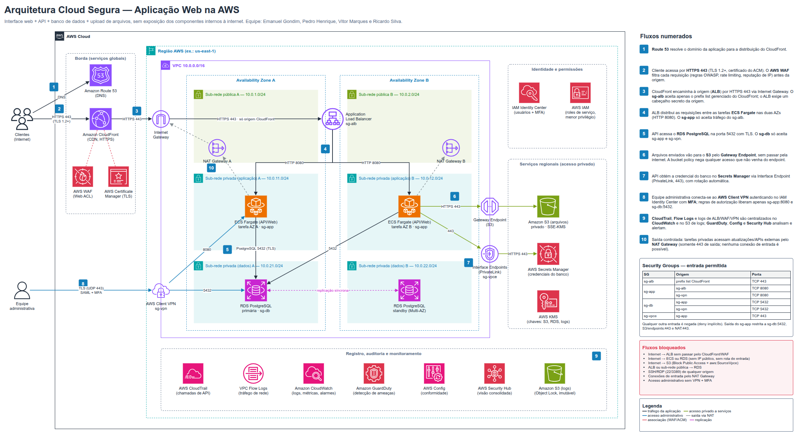

# Arquitetura Cloud Segura — Justificativa Técnica

- **Tema:** Segurança Cloud: IAM, Redes e Boas Práticas
- **Provedor:** Amazon Web Services (AWS)
- **Equipe:** Emanuel Gondim, Pedro Henrique, Vitor Marques e Ricardo Silva
- **Diagrama editável:** `arquitetura-cloud-segura.drawio` (Figura 1)

## 1. Visão geral

A aplicação (interface web, API, banco de dados e armazenamento de arquivos) foi projetada para que **apenas um ponto de entrada seja público**: a distribuição do Amazon CloudFront, protegida pelo AWS WAF. Os demais componentes ficam em sub-redes privadas de uma VPC dedicada ou em serviços gerenciados acessados por caminhos privados.

A arquitetura segue quatro princípios:

1. **Defesa em profundidade:** a requisição passa por várias camadas independentes (WAF → CloudFront → ALB → Security Groups → aplicação → banco). Uma falha em uma camada não expõe as demais.
2. **Isolamento por camadas de rede:** a VPC é dividida em sub-redes públicas, privadas de aplicação e privadas de dados, replicadas em duas Availability Zones.
3. **Menor privilégio:** cada pessoa e cada serviço recebe apenas as permissões e portas necessárias.
4. **Rastreabilidade:** todas as ações administrativas, chamadas de API e fluxos de rede são registrados e analisados.

Correspondência com os requisitos do enunciado:

| # | Requisito | Como é atendido |
|---|---|---|
| 1 | Acesso pela internet via HTTPS | Route 53 + CloudFront com certificado do ACM (TLS 1.2+), redirecionamento HTTP → HTTPS |
| 2 | Proteção e distribuição de requisições | AWS WAF no CloudFront; Application Load Balancer distribuindo entre duas AZs |
| 3 | API processa requisições e acessa recursos | ECS Fargate em sub-redes privadas, com IAM Task Role específica |
| 4 | Banco sem acesso direto pela internet | RDS PostgreSQL Multi-AZ em sub-redes privadas de dados, sem IP público |
| 5 | Arquivos em serviço apropriado com acesso controlado | Bucket S3 privado, Block Public Access, SSE-KMS, acesso apenas pelo VPC Gateway Endpoint |
| 6 | Acesso administrativo seguro | AWS Client VPN com autenticação federada (IAM Identity Center) e MFA |
| 7 | Comunicação limitada ao necessário | Security Groups encadeados por referência, NACLs por camada, endpoints privados |
| 8 | Registro e análise de eventos | CloudTrail, VPC Flow Logs, logs de ALB/WAF/VPN, CloudWatch, GuardDuty, Config, Security Hub |
| 9 | Menor privilégio | IAM Identity Center com grupos e permission sets; roles de serviço com políticas restritas; Secrets Manager |



## 2. Componentes e motivo de cada um

### 2.1 Borda (entrada pública)

| Componente | Por que foi incluído |
|---|---|
| **Amazon Route 53** | DNS gerenciado do domínio da aplicação. Aponta (registro *alias*) para o CloudFront, de modo que o cliente nunca conhece o endereço do ALB. |
| **Amazon CloudFront** | Único ponto público da aplicação. Termina o TLS próximo ao usuário, absorve picos de tráfego e ataques volumétricos (AWS Shield Standard incluso) e faz cache do conteúdo estático da interface web. |
| **AWS Certificate Manager (ACM)** | Emite e renova automaticamente os certificados TLS usados pelo CloudFront e pelo ALB. Elimina o risco de certificado expirado ou chave privada armazenada manualmente. |
| **AWS WAF** | Firewall de aplicação web associado ao CloudFront. Aplica regras gerenciadas (OWASP Top 10: SQL injection, XSS), lista de IPs maliciosos (*IP reputation*) e *rate limiting* por IP, barrando ataques antes que cheguem à VPC. |

### 2.2 Rede (VPC)

| Componente | Por que foi incluído |
|---|---|
| **VPC 10.0.0.0/16** | Rede isolada que delimita todo o ambiente da aplicação. Nenhum tráfego entra ou sai sem passar por um gateway ou endpoint explicitamente configurado. |
| **2 Availability Zones** | Alta disponibilidade: a falha de um data center não derruba a aplicação. Cada camada de sub-rede existe nas duas AZs. |
| **Internet Gateway** | Permite a comunicação da VPC com a internet, mas **somente** para recursos em sub-redes públicas (ALB e NAT Gateway). |
| **NAT Gateway (um por AZ)** | Permite que as tarefas privadas iniciem conexões de saída (atualizações, APIs externas) sem receber nenhuma conexão de entrada. |
| **VPC Gateway Endpoint (S3)** | Caminho privado entre a VPC e o S3 pela rede interna da AWS. Ver seção 6. |
| **VPC Interface Endpoints (PrivateLink)** | ENIs privadas para Secrets Manager, CloudWatch Logs, ECR e KMS. As tarefas usam esses serviços sem sair para a internet. |

### 2.3 Processamento e dados

| Componente | Por que foi incluído |
|---|---|
| **Application Load Balancer (ALB)** | Distribui as requisições entre as tarefas nas duas AZs, faz *health checks* e remove instâncias com falha. Fica nas sub-redes públicas porque precisa receber o tráfego vindo do CloudFront, mas só o aceita dessa origem (seção 4). |
| **Amazon ECS com AWS Fargate** | Executa a API e a interface web em contêineres **sem servidores para administrar**: não há sistema operacional exposto, SSH ou patches de host sob responsabilidade da equipe, o que reduz a superfície de ataque. Escala automaticamente conforme a carga. |
| **Amazon RDS PostgreSQL (Multi-AZ)** | Banco relacional gerenciado com backups automáticos, criptografia em repouso (KMS) e em trânsito (TLS obrigatório) e réplica *standby* síncrona em outra AZ para *failover* automático. |
| **Amazon S3 (arquivos dos usuários)** | Armazenamento de objetos durável e escalável para os uploads. Configurado como privado, com versionamento e criptografia SSE-KMS. |

### 2.4 Identidade, credenciais e criptografia

| Componente | Por que foi incluído |
|---|---|
| **AWS IAM Identity Center** | Login único da equipe, com **MFA obrigatório**, grupos (ex.: `Administradores`, `Desenvolvedores`, `Auditoria`) e *permission sets* com credenciais temporárias. Também é o provedor SAML do Client VPN. |
| **AWS IAM (roles de serviço)** | Cada serviço assume uma role própria com política mínima (seção 7). Nenhuma *access key* fixa é usada na aplicação. |
| **AWS Secrets Manager** | Guarda a credencial do banco com **rotação automática**. A aplicação busca a senha em tempo de execução: nada fica no código, na imagem ou em variáveis de ambiente em texto claro. |
| **AWS KMS** | Chaves gerenciadas pelo cliente para criptografar S3, RDS, Secrets Manager e logs, com política de chave limitando quem pode usá-las e uso registrado no CloudTrail. |

### 2.5 Registro e monitoramento

| Componente | Por que foi incluído |
|---|---|
| **AWS CloudTrail** | Registra todas as chamadas de API da conta (quem fez o quê, quando e de onde). Trilha multirregião com validação de integridade dos arquivos. |
| **VPC Flow Logs** | Registram os fluxos de rede aceitos e rejeitados nas interfaces da VPC. |
| **Amazon CloudWatch** | Centraliza logs (aplicação, ALB, WAF, Client VPN, Flow Logs), métricas e alarmes, que notificam a equipe via Amazon SNS. |
| **Amazon GuardDuty** | Detecção de ameaças por análise contínua de CloudTrail, Flow Logs e DNS (ex.: credenciais usadas de IP incomum, comunicação com servidores maliciosos). |
| **AWS Config** | Inventário e histórico de configuração, com regras que detectam desvios (ex.: bucket público, Security Group com 0.0.0.0/0 na porta 22, RDS sem criptografia). |
| **AWS Security Hub** | Painel único que consolida os achados do GuardDuty, Config e IAM Access Analyzer e os compara com o padrão *AWS Foundational Security Best Practices*. |
| **Amazon S3 (logs)** | Bucket separado para retenção de longo prazo, com **Object Lock** (imutável) e acesso restrito à equipe de auditoria. |


## 3. Sub-redes públicas e privadas

| Camada | CIDR (AZ A / AZ B) | Componentes | Rota para a internet | Motivo |
|---|---|---|---|---|
| **Pública** | 10.0.1.0/24 · 10.0.2.0/24 | ALB, NAT Gateway | `0.0.0.0/0 → Internet Gateway` | Precisam de endereço alcançável pela internet: o ALB para receber o tráfego do CloudFront, o NAT para encaminhar a saída das sub-redes privadas. |
| **Privada (aplicação)** | 10.0.11.0/24 · 10.0.12.0/24 | Tarefas ECS Fargate, Interface Endpoints, ENIs do Client VPN | `0.0.0.0/0 → NAT Gateway` (somente saída) | A API não precisa ser alcançada diretamente; só recebe tráfego do ALB e da VPN. Sem IP público. |
| **Privada (dados)** | 10.0.21.0/24 · 10.0.22.0/24 | RDS primário e *standby* | **Nenhuma** rota para a internet | O banco é o ativo mais sensível: não inicia nem recebe conexões externas, só fala com a camada de aplicação. |

A separação em três camadas significa que, mesmo que alguém comprometa um componente da camada pública, não existe rota nem regra que permita alcançar o banco diretamente a partir dela.


## 4. Fluxos de comunicação

### 4.1 Conexões permitidas

| # | Origem | Destino | Protocolo | Porta | Finalidade |
|---|---|---|---|---|---|
| 1 | Clientes (internet) | Route 53 | UDP/TCP (DNS) | 53 | Resolver o domínio da aplicação |
| 2 | Clientes (internet) | CloudFront (+ WAF) | HTTPS (TCP) | 443 | Acessar a interface web e a API |
| 3 | CloudFront | ALB (sg-alb), via Internet Gateway | HTTPS (TCP) | 443 | Encaminhar requisições à origem |
| 4 | ALB (sg-alb) | ECS Fargate (sg-app) | HTTP (TCP) | 8080 | Entregar requisições às tarefas da aplicação |
| 5 | ECS Fargate (sg-app) | RDS PostgreSQL (sg-db) | PostgreSQL sobre TLS (TCP) | 5432 | Ler e gravar dados da aplicação |
| 6 | ECS Fargate (sg-app) | S3 via Gateway Endpoint | HTTPS (TCP) | 443 | Gravar e ler arquivos dos usuários |
| 7 | ECS Fargate (sg-app) | Interface Endpoints (sg-vpce): Secrets Manager, ECR, CloudWatch Logs, KMS | HTTPS (TCP) | 443 | Obter credenciais, baixar imagens, enviar logs, criptografar |
| 8a | Equipe administrativa | AWS Client VPN | OpenVPN sobre TLS (UDP) | 443 | Estabelecer o túnel administrativo autenticado com MFA |
| 8b | Client VPN (sg-vpn) | RDS (sg-db) | PostgreSQL sobre TLS (TCP) | 5432 | Manutenção do banco (migrações, consultas administrativas) |
| 8c | Client VPN (sg-vpn) | ECS Fargate (sg-app) | HTTP (TCP) | 8080 | Endpoints internos de diagnóstico e *health check* |
| 9 | Serviços AWS (ALB, WAF, VPC, VPN, CloudTrail) | CloudWatch Logs / S3 de logs | HTTPS (interno AWS) | 443 | Registro de eventos para auditoria |
| 10 | ECS Fargate (sg-app) | Internet, via NAT Gateway → Internet Gateway | HTTPS (TCP) | 443 | Saída para APIs externas e atualizações (sem entrada) |
| — | RDS primário | RDS *standby* (outra AZ) | Replicação gerenciada pela AWS | — | Alta disponibilidade (Multi-AZ) |

### 4.2 Regras dos Security Groups

Os Security Groups referenciam **outros Security Groups** (e não faixas de IP). Assim, a regra continua correta mesmo quando as tarefas mudam de endereço ao escalar.

| Security Group | Associado a | Entrada permitida | Saída permitida |
|---|---|---|---|
| **sg-alb** | ALB | TCP 443 a partir do *prefix list* gerenciado `com.amazonaws.global.cloudfront.origin-facing` | TCP 8080 → sg-app |
| **sg-app** | Tarefas ECS Fargate | TCP 8080 ← sg-alb; TCP 8080 ← sg-vpn | TCP 5432 → sg-db; TCP 443 → *prefix list* do S3; TCP 443 → sg-vpce; TCP 443 → 0.0.0.0/0 (via NAT) |
| **sg-db** | RDS PostgreSQL | TCP 5432 ← sg-app; TCP 5432 ← sg-vpn | Nenhuma regra adicional necessária |
| **sg-vpce** | Interface Endpoints | TCP 443 ← sg-app | — |
| **sg-vpn** | ENIs do Client VPN | (conexões dos clientes VPN autenticados) | TCP 5432 → sg-db; TCP 8080 → sg-app |

Além do Security Group, o ALB só encaminha requisições que tragam um **cabeçalho HTTP secreto** inserido pelo CloudFront (o valor fica no Secrets Manager e é rotacionado). Isso impede que alguém use outra distribuição CloudFront para contornar o WAF.

### 4.3 Network ACLs (segunda camada, sem estado)

| Sub-rede | Entrada permitida | Bloqueado explicitamente |
|---|---|---|
| Pública | TCP 443 de 0.0.0.0/0; portas efêmeras 1024–65535 (retorno) | TCP 22 e 3389 de qualquer origem |
| Privada (aplicação) | TCP 8080 das sub-redes públicas; TCP 8080 da faixa do Client VPN (10.100.0.0/22); TCP 443 da própria VPC; efêmeras de retorno | Todo o resto |
| Privada (dados) | TCP 5432 das sub-redes de aplicação e da faixa do Client VPN; efêmeras de retorno para essas mesmas faixas | Todo o resto, inclusive as sub-redes públicas |

### 4.4 Conexões bloqueadas

| Origem | Destino | Como é bloqueado |
|---|---|---|
| Internet | ALB diretamente (sem CloudFront) | sg-alb aceita apenas o *prefix list* do CloudFront, e o ALB exige o cabeçalho secreto |
| Internet | Tarefas ECS ou RDS | Sub-redes privadas, sem IP público e sem rota de entrada; nenhum SG libera 0.0.0.0/0 |
| Internet | Bucket S3 | *Block Public Access* na conta e no bucket, bucket policy com `Deny` fora do `aws:SourceVpce` |
| ALB / sub-redes públicas | RDS | sg-db não referencia sg-alb; a NACL de dados não aceita CIDRs públicos |
| Sub-redes de dados | Internet | Tabela de rotas sem rota `0.0.0.0/0` |
| Qualquer origem | SSH (22) / RDP (3389) | Nenhum SG libera essas portas (Fargate não possui shell exposto); as NACLs as negam explicitamente; uma regra do AWS Config alerta se forem abertas |
| Internet | Conexões de entrada pelo NAT Gateway | O NAT só traduz conexões iniciadas de dentro para fora |
| Equipe sem VPN ou sem MFA | Recursos internos | Não há caminho de rede alternativo; o Client VPN exige SAML + MFA |


## 5. Proteção do acesso administrativo

O enunciado pede uma forma segura de acessar os recursos internos. A escolha foi o **AWS Client VPN**.

**Problema que resolve:** o banco e a aplicação não têm IP público, então não podem ser acessados da internet. Abrir portas para os IPs dos administradores seria frágil (IPs mudam, credenciais podem vazar) e um *bastion host* com SSH acrescentaria mais um servidor exposto para manter e corrigir.

**Por que é adequado ao cenário:**

- **Autenticação forte:** login federado (SAML) pelo IAM Identity Center com **MFA obrigatório**. Desligar o usuário no Identity Center revoga o acesso à VPN na hora.
- **Criptografia:** todo o tráfego administrativo trafega em túnel TLS.
- **Autorização granular:** as *authorization rules* do Client VPN são vinculadas ao grupo do usuário. Somente o grupo `Administradores` alcança as sub-redes de aplicação e dados, e o sg-vpn só libera as portas 5432 (sg-db) e 8080 (sg-app).
- **Faixa de IP própria (10.100.0.0/22):** os clientes VPN recebem endereços distintos da VPC, o que facilita identificá-los nos Flow Logs e nas NACLs.
- **Rastreabilidade:** os *connection logs* do Client VPN vão para o CloudWatch (usuário, horário, IP de origem, duração).
- **Sem bastion e sem SSH:** nenhuma porta de administração fica aberta para a internet.

O acesso ao **console e à API da AWS** também passa pelo IAM Identity Center com MFA e credenciais temporárias. O usuário *root* da conta tem MFA de hardware e não é usado no dia a dia.


## 6. Acesso privado ao armazenamento (VPC Endpoint)

**Problema que resolve:** sem endpoint, a API alcançaria o S3 pelo NAT Gateway e pela internet pública, e o bucket precisaria aceitar requisições vindas da internet (ainda que autenticadas).

**Solução adotada:**

1. **Gateway Endpoint do S3** associado às tabelas de rotas das sub-redes de aplicação: o tráfego para o S3 fica na rede da AWS, sem custo por GB e sem depender do NAT.
2. **Bucket policy** com negação explícita para qualquer requisição que não venha do endpoint:

   ```json
   {
     "Effect": "Deny",
     "Principal": "*",
     "Action": "s3:*",
     "Resource": ["arn:aws:s3:::app-uploads", "arn:aws:s3:::app-uploads/*"],
     "Condition": { "StringNotEquals": { "aws:SourceVpce": "vpce-0abc123" } }
   }
   ```

3. **Block Public Access**, **SSE-KMS** obrigatório, **versionamento** (recuperação de arquivos sobrescritos ou apagados) e negação de requisições sem TLS (`aws:SecureTransport = false`).
4. A **endpoint policy** permite apenas o bucket da aplicação, o que impede o uso do endpoint para exfiltrar dados a outros buckets.

Os uploads passam pela API, que valida tipo, tamanho e permissão do usuário antes de gravar no S3. Os **Interface Endpoints** (PrivateLink) aplicam a mesma lógica aos serviços Secrets Manager, ECR, CloudWatch Logs e KMS.


## 7. Limitação de permissões (menor privilégio)

### 7.1 Pessoas

| Grupo (IAM Identity Center) | Permission set | Acesso |
|---|---|---|
| Administradores | Administração da infraestrutura | Gerenciar recursos; acesso à VPN; sessão de no máximo 4 h |
| Desenvolvedores | Somente leitura + deploy no ECS | Ver logs e métricas, publicar novas versões; **sem** acesso aos dados do RDS ou do S3 |
| Auditoria | `SecurityAudit` + leitura do bucket de logs | Investigar eventos; não altera recursos |

- MFA obrigatório para todos; nenhum usuário IAM com *access key* permanente.
- Credenciais temporárias, revisões periódicas de acesso e IAM Access Analyzer para detectar permissões excessivas ou recursos compartilhados externamente.

### 7.2 Serviços

| Role | Usada por | Permissões |
|---|---|---|
| **Task Execution Role** | Agente do ECS | Baixar a imagem do ECR e gravar logs no CloudWatch; nada além disso |
| **Task Role** | Código da aplicação | `s3:GetObject`/`s3:PutObject` somente em `app-uploads/*`; `secretsmanager:GetSecretValue` somente no segredo do banco; `kms:Decrypt` somente na chave da aplicação |
| **Role de rotação** | Função de rotação do Secrets Manager | Alterar a senha do usuário da aplicação no RDS |
| **Role do Flow Logs / CloudTrail** | Serviços de log | Gravar apenas no grupo de logs ou bucket de destino |

No banco, o usuário da aplicação tem apenas `SELECT/INSERT/UPDATE/DELETE` no esquema da aplicação. Alterações de esquema usam um usuário de migração separado, disponível somente pela VPN.


## 8. Como a arquitetura reduz riscos

| Risco | Mitigações |
|---|---|
| **Exposição de dados** | Banco e arquivos sem acesso público; criptografia em repouso (KMS) e em trânsito (TLS em todos os saltos externos e no banco); S3 acessível apenas via endpoint; segredos fora do código |
| **Acesso não autorizado** | Único ponto de entrada (CloudFront + WAF); SGs encadeados; NACLs; MFA para pessoas; roles com escopo mínimo; VPN obrigatória para manutenção |
| **Ataques à aplicação** | WAF com regras OWASP e *rate limiting*; Shield Standard contra DDoS; ALB oculto atrás do CloudFront |
| **Movimento lateral** | Três camadas de sub-rede; cada SG libera só a porta da camada seguinte; banco sem rota para a internet (dificulta exfiltração) |
| **Credenciais vazadas** | Credenciais temporárias; rotação automática no Secrets Manager; GuardDuty detecta uso anômalo |
| **Indisponibilidade** | Duas AZs; ALB com *health checks*; RDS Multi-AZ; Fargate com *auto scaling* |
| **Mudanças inseguras** | AWS Config detecta e alerta sobre configurações fora do padrão |


## 9. Auditoria e identificação de atividades suspeitas

Cada fonte de log responde a uma pergunta diferente durante uma investigação:

| Fonte | Responde | Exemplo de atividade suspeita detectada |
|---|---|---|
| **CloudTrail** | Quem fez qual ação na conta, quando e de onde? | Exclusão de trilha, alteração de Security Group abrindo a porta 22, login no console sem MFA, uso do usuário *root* |
| **VPC Flow Logs** | Quais conexões de rede ocorreram e quais foram rejeitadas? | Varredura de portas, tentativas repetidas no RDS a partir de origem inesperada, volume anormal de saída (exfiltração) |
| **Logs do WAF / ALB** | Quais requisições chegaram e quais foram bloqueadas? | Picos de SQL injection, *brute force* em `/login`, IPs com excesso de requisições |
| **Logs do Client VPN** | Quem acessou a rede interna e por quanto tempo? | Conexão fora do horário, de país incomum, sessões simultâneas do mesmo usuário |
| **GuardDuty** | Há comportamento malicioso conhecido? | Credencial usada de IP malicioso, comunicação com servidor de *command and control*, mineração de criptomoeda |
| **AWS Config** | A configuração mudou para um estado inseguro? | Bucket que se tornou público, RDS sem criptografia, SG com 0.0.0.0/0 |

**Fluxo de resposta:** os eventos chegam ao CloudWatch e ao Security Hub. Filtros de métrica e alarmes (ex.: `ConsoleLogin` sem MFA, `DeleteTrail`, `AuthorizeSecurityGroupIngress`, aumento de 4xx/5xx, muitas requisições bloqueadas pelo WAF) disparam notificações via SNS para a equipe. Os logs ficam retidos no bucket S3 com **Object Lock**, de modo que nem um invasor com privilégios consegue apagá-los, o que preserva as evidências para análise forense e auditorias de conformidade.


## 10. Resumo das decisões

| Decisão | Alternativa descartada | Motivo |
|---|---|---|
| CloudFront + WAF na borda | ALB exposto diretamente | Um único ponto de entrada filtrado; mitigação de DDoS; ALB oculto |
| ECS Fargate | EC2 com Auto Scaling | Sem SO para corrigir nem SSH para proteger; menor superfície de ataque |
| RDS Multi-AZ em sub-rede de dados | Banco em EC2 ou na mesma sub-rede da aplicação | Serviço gerenciado com criptografia e *failover*; isolamento adicional de rede |
| S3 via Gateway Endpoint | S3 via NAT/internet | Tráfego privado, bucket policy restrita à VPC, sem custo de NAT |
| AWS Client VPN + MFA | Bastion host com SSH | Sem servidor exposto; autenticação federada; logs de conexão |
| Secrets Manager | Senhas em variáveis de ambiente ou no código | Rotação automática; acesso auditado; nada sensível no repositório |
| SGs referenciando SGs | Regras por faixa de IP | Regras corretas mesmo com IPs dinâmicos; menor privilégio de rede |
